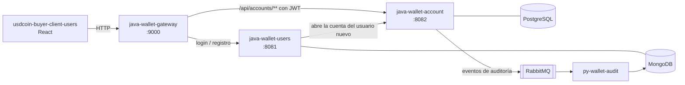

# py-wallet-audit

[](https://github.com/josejps84/py-wallet-audit/actions/workflows/ci.yml)

Servicio de **auditoría** de la billetera:
- Consume los eventos que publica `java-wallet-account` en RabbitMQ (creación y edición de cuentas, depósitos y retiros).
- Los guarda en MongoDB como registro histórico de lo que pasó con cada cuenta.



| Repo | Rol |
|---|---|
| [java-wallet-gateway](https://github.com/josejps84/java-wallet-gateway) | Punto de entrada único; valida el JWT y enruta |
| [java-wallet-users](https://github.com/josejps84/java-wallet-users) | Registro, login y emisión de JWT |
| [java-wallet-account](https://github.com/josejps84/java-wallet-account) | Cuentas y movimientos; publica los eventos |
| **py-wallet-audit** | Guarda los eventos de auditoría (este repo) |
| [usdcoin-buyer-client-users](https://github.com/josejps84/usdcoin-buyer-client-users) | Interfaz web |

## Stack

Python 3.14 · asyncio · aio-pika (RabbitMQ) · PyMongo async (MongoDB) · pytest y Testcontainers.

## Cómo funciona

Todo está en [`main.py`](main.py):

1. **Arranque:** lee la configuración y termina con un error claro si falta alguna variable. Luego verifica la conexión a MongoDB.
2. **Conexión:** se conecta a RabbitMQ con reconexión automática (`connect_robust`) y declara la cola durable `audit_queue`.
3. **Procesamiento:** procesa hasta 10 mensajes a la vez (`prefetch_count=10`). Cada mensaje corre en su propia tarea, con referencias guardadas y la concurrencia limitada con un semáforo.
4. **Resultado de cada mensaje:**

| Situación | Qué hace |
|---|---|
| JSON válido | Lo guarda con `receivedAt` y hace **ack** |
| Trae `eventId` | Lo usa como `_id`: si el mismo evento llega dos veces, se guarda una sola vez |
| Evento ya guardado | **ack** sin error |
| No es JSON, o no es un objeto | **reject sin reencolar**; si no, fallaría para siempre |
| Error de MongoDB | Espera 2 s y hace **nack con reencolado** para reintentarlo |

5. **Apagado:** con `SIGINT` o `SIGTERM` (por ejemplo, `docker stop`) deja de consumir, espera a que terminen los mensajes en curso y cierra las conexiones.

Ejemplo de documento guardado en `audit_logs`:

```json
{
  "_id": "729571a9-34d0-4f62-b497-03429480acb0",
  "eventId": "729571a9-34d0-4f62-b497-03429480acb0",
  "type": "DEPOSIT",
  "accountNmbr": "e79efbaa-99dd-42ce-98e7-176c77df3458",
  "accountUserId": 1,
  "performedBy": 1,
  "amount": 100.10,
  "balance": 100.10,
  "occurredAt": "2026-11-20T18:29:25.443Z",
  "receivedAt": "2026-11-20T18:29:25.501Z"
}
```

## Configuración

Por variables de entorno, o en un archivo `.env` en la raíz del repo (está en `.gitignore`; ver [`.env.example`](.env.example)). Todas son obligatorias.

| Variable | Ejemplo | Descripción |
|---|---|---|
| `RABBITMQ_URL` | `amqp://admin:<password>@localhost:5672/` | Conexión a RabbitMQ |
| `MONGODB_URL` | `mongodb://admin:<password>@localhost:27017/?authSource=admin` | Conexión a MongoDB |
| `MONGO_DB_NAME` | `accounts` | Base de datos |
| `MONGO_COLLECTION` | `audit_logs` | Colección |
| `QUEUE_NAME` | `audit_queue` | Cola que publica `java-wallet-account` |

## Ejecutar en local

```sh
python -m venv .venv
.venv/bin/pip install -r requirements.txt
cp .env.example .env   # completar las credenciales
.venv/bin/python main.py
```

Necesita RabbitMQ y MongoDB corriendo; ver los comandos `docker run` en los README de [java-wallet-account](https://github.com/josejps84/java-wallet-account#ejecutar-en-local) y [java-wallet-users](https://github.com/josejps84/java-wallet-users#ejecutar-en-local).

### Docker

```sh
docker build -t wallet-audit .
docker run -e RABBITMQ_URL=... -e MONGODB_URL=... -e MONGO_DB_NAME=accounts \
  -e MONGO_COLLECTION=audit_logs -e QUEUE_NAME=audit_queue wallet-audit
```

## Tests

```sh
.venv/bin/pip install -r requirements-dev.txt
.venv/bin/python -m pytest                       # todos
.venv/bin/python -m pytest -m "not integration"  # sin Docker
```

- **`test_process_and_save.py`:** ack, rechazo de 5 tipos de mensaje mal formado, duplicados y reencolado ante errores de Mongo.
- **`test_settings.py`:** validación de variables obligatorias, sin leer el `.env` local.
- **`test_integration.py`:** levanta RabbitMQ y MongoDB con Testcontainers y corre el consumidor real. Comprueba que un evento duplicado se guarda una vez, que el mal formado se descarta y que la cola queda vacía. Si no hay Docker disponible, se salta.

El [workflow de CI](.github/workflows/ci.yml) corre pytest en cada push a `main` y en cada pull request.
